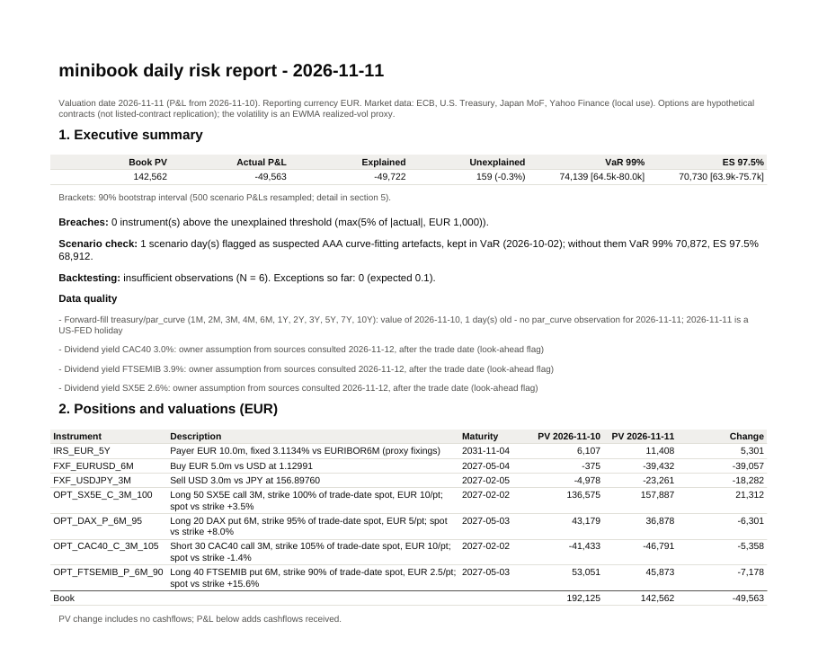
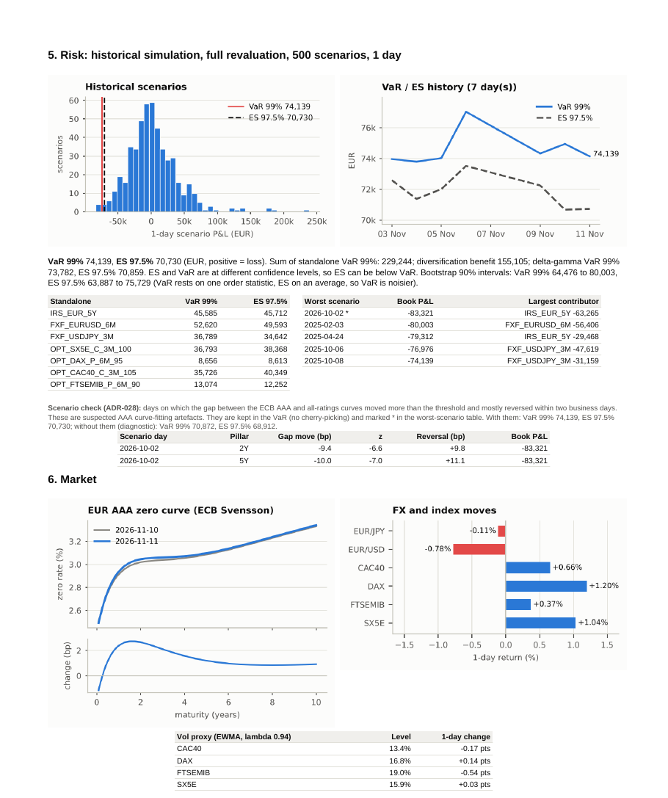
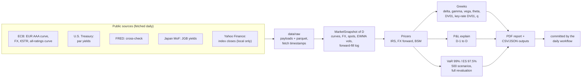

# minibook

[](https://github.com/nadirsayed/minibook/actions/workflows/ci.yml)
[](https://github.com/nadirsayed/minibook/actions/workflows/daily.yml)


**A small multi-asset derivatives book, risk-managed every business day from real public
market data.** minibook values a EUR interest rate swap, two FX forwards and four equity
index options; computes their Greeks; explains the day's P&L factor by factor; measures
1-day 99% VaR and 97.5% Expected Shortfall by full-revaluation historical simulation; and
publishes a PDF risk report. It runs unattended on GitHub Actions and commits each day's
report.

Pricing, curves, calendars and risk are built from scratch with numpy/scipy. QuantLib is
used only in the tests, as an independent cross-check.

**Latest reports: [reports/](reports/README.md)**: one PDF per TARGET business day since
the trade date (2 November 2026), with the headline P&L, VaR and ES.

<p align="center">
  
  
</p>

## The book

Traded on 2 November 2026; terms frozen by `minibook init-book` at that date's market.

| Instrument | Position | Frozen at the trade date |
|---|---|---|
| EUR interest rate swap, 5Y | Pay fixed on EUR 10m vs EURIBOR 6M | Fixed rate = par rate |
| EUR/USD forward, 6M | Buy EUR 5m vs USD | Strike = outright forward |
| USD/JPY forward, 3M | Sell USD 3m vs JPY | Strike = outright forward |
| Euro Stoxx 50 call, 3M, 100% | Long 50, EUR 10/pt | Strike = 100% of spot |
| DAX put, 6M, 95% | Long 20, EUR 5/pt | Strike = 95% of spot |
| CAC 40 call, 3M, 105% | Short 30, EUR 10/pt | Strike = 105% of spot |
| FTSE MIB put, 6M, 90% | Long 40, EUR 2.5/pt | Strike = 90% of spot |

The options are hypothetical European contracts with a continuous dividend yield, not
replicas of listed contracts. Their strikes depend on index closes, so they are kept in a
git-ignored file (`config/book.private.yaml`); `config/book.yaml` holds only a SHA-256
digest of them ([ADR-018](docs/decisions.md)).

## How it works



## Quickstart

Requires [uv](https://docs.astral.sh/uv/) and network access. About two minutes on a
fresh clone, most of it the data download.

```bash
git clone https://github.com/nadirsayed/minibook && cd minibook
uv sync
```

Run the test suite (offline, from recorded real responses and labelled synthetic data):

```bash
uv run pytest
```

Reproduce a report from live data:

```bash
uv run minibook fetch --full
```

```bash
uv run minibook init-book --trade-date 2026-11-02
```

```bash
uv run minibook run --date 2026-11-11
```

`fetch --full` downloads the history since June 2023 into the git-ignored `data/raw/`.
On a fresh clone, `init-book` rebuilds the private option terms from your own copy of
the index closes and writes them only if they match the committed digest. `run` writes
`output/2026-11-11/` and `reports/2026-11-11.pdf` in about 5 seconds. The data outputs
are byte-identical to the committed ones; only the fetch timestamps in the report notes
differ. Index closes come from Yahoo Finance via yfinance, for personal, non-commercial
use only.

Other commands: `minibook backfill --start ... --end ...` (a range of TARGET days) and
`minibook daily` (the scheduled job: catch up every missing day once the ECB curve is
published).

## Methodology at a glance

Full detail: [docs/methodology.md](docs/methodology.md). Every choice and its reasons:
[docs/decisions.md](docs/decisions.md) (28 ADRs).

- **Curves.** EUR: the ECB's Svensson AAA government curve, rebuilt from its published
  parameters (within 0.1 bp of the ECB's own spot rates) and sampled on 38 pillars. USD:
  U.S. Treasury par yields bootstrapped to zero rates, cross-checked against FRED (flag
  above 1 bp). JPY: JGB par yields, flat below 1Y. Zero rates are continuously compounded,
  linearly interpolated, flat-extrapolated.
- **Pricers.** Swap: single curve, par-coupon forwarding, EURIBOR fixings from a
  curve-implied proxy stored immutably on each fixing date. FX forwards: discounted from
  the spot date, so a forward struck at the outright has zero value. Options:
  Black-Scholes-Merton with a continuous dividend yield and an EWMA (λ = 0.94)
  realized-vol proxy.
- **Greeks.** Analytic option and FX Greeks; theta by one-day revaluation; DV01 and
  key-rate DV01 (3M to 10Y) by central differences; dividend-yield sensitivity per +10 bp.
- **P&L explain.** Actual P&L (including cashflows) vs a Taylor explain: period theta,
  delta, gamma, vega, rates, FX. Breach when the unexplained exceeds max(5% of |actual|,
  EUR 1,000). Also a step-by-step revaluation attribution, in a stated order.
- **VaR and ES.** 500 one-day historical scenarios of 71 risk factors (zero-rate pillars,
  FX, index returns, vol changes), applied to today's market with full revaluation.
  VaR99 is the 5th worst P&L, ES97.5 the mean of the 13 worst. The report adds standalone
  and diversified figures, the worst scenarios, a delta-gamma comparison, seeded bootstrap
  intervals, and an automated flag for scenarios that look like curve-fitting artefacts.
  Flagged scenarios are never dropped. Backtesting: Kupiec and the Basel traffic light
  once 250 observations exist; before that, "insufficient observations".

## Sign conventions

| Quantity | Convention |
|---|---|
| PV, P&L | EUR, from the book's point of view; P&L > 0 is a gain |
| VaR, ES | EUR, positive numbers are losses |
| Delta | EUR change for a +1% move of the index spot or of the FX rate EUR/ccy |
| Gamma | (1% of spot)² × second derivative, EUR |
| Vega | EUR per +1 vol point |
| Theta | EUR per calendar day, market held constant (constant zero rates per tenor) |
| DV01, key-rate DV01 | [PV(+1 bp) − PV(−1 bp)] / 2, EUR; a payer swap has positive DV01 |
| Dividend sensitivity | EUR per +10 bp of dividend yield |
| Unexplained | actual − explained |

## What the tests prove

230 tests, 97% line and branch coverage, all offline. CI runs ruff, mypy `--strict`, and
pytest on every push.

- **Independent cross-checks against QuantLib**: swap NPV, leg values (to EUR 1e-4) and
  par rate (1e-12); BSM price, delta, gamma and vega (relative 1e-12); TARGET and exchange
  calendars 2022-2030; day counts; schedules.
- **Real data**: the rebuilt ECB Svensson curve matches the ECB's published spot rates
  within 0.1 bp on every recorded day; the bootstrap reprices every recorded Treasury and
  JGB quote to 1e-8 bp.
- **Finance identities**: covered interest parity and triangular FX consistency; swaps
  and forwards have zero PV when struck at the trade date; key-rate DV01s add up to the
  parallel DV01; analytic Greeks match central differences.
- **P&L explain**: residuals shrink at the expected order (cubic for a pure spot move);
  steps add up to the total; changing the step order changes the split, not the total.
- **VaR**: definitions on known ranks; Gaussian P&L matches the analytic quantile;
  ES ≥ VaR at the same level (property-based, Hypothesis); diversification can be
  negative; full revaluation vs delta-gamma; no look-ahead in scenarios.
- **Rules**: no index level appears in any committed output or report; forward-fill
  limits; no intraday or future equity bars; a wrong private-terms file is detected;
  identical inputs give byte-identical reports.

## Daily reports

A risk report is produced for every TARGET business day after the trade date (2 November
2026). It runs on the next TARGET business day, once the ECB has published its yield curve
for the day (around noon CET); the scheduled GitHub Actions workflow "Daily report" retries
every hour until 18:00 CET.

- PDF reports, one per valuation date: [reports/](reports/)
- Data outputs (valuations, Greeks, P&L explain, VaR/ES, run metadata): [output/](output/)

Reports produced after the fact (backfills) say so in their notes. No committed file shows an
index level: option strikes appear as a percentage of the trade-date spot, index moves as
returns.

## Limitations

- **The EUR swap is discounted and projected on the ECB AAA government curve**, a proxy for
  the swap curve. A proper €STR-discounted EURIBOR 6M curve built from swap quotes is the
  real fix (roadmap); none of the free sources used here publishes a EUR swap curve. The
  proxy also lets AAA curve-fitting artefacts into the VaR scenarios: 2 October 2026 is
  flagged as one and kept ([ADR-026, ADR-028](docs/decisions.md)).
- **Volatility is an EWMA realized-vol proxy**, not implied vol. Realized vol usually sits
  below implied, so option values are likely understated vs the market. EWMA vol changes
  are driven by the day's squared return, so vega and delta/gamma P&L are not independent.
- **Dividends are a flat yield** entered by the owner from factsheets consulted after the
  trade date (look-ahead flagged in `config/book.yaml` and the report).
- **USD and JPY use government curves** (no OIS, no cross-currency basis). The JPY curve is
  flat below 1Y.
- **EURIBOR fixings are a curve-implied proxy**, not the licensed fixings.
- **Step attribution depends on the order** of the steps (always stated in the report).
- **Backtesting needs 250 observations**; until then the report shows the exception count
  only.
- **Equity closes come from Yahoo Finance** (personal use, local cache, never committed);
  Swiss-holiday gaps in the Euro Stoxx 50 series are forward-filled and logged.

## Roadmap (beyond v1.0.0)

- EUR swap curve: €STR discounting and a EURIBOR 6M projection curve bootstrapped from
  deposit, FRA and swap quotes, replacing the AAA government-curve proxy.
- JPY short-end anchor: the curve is flat below 1Y today (no free JPY money-market data
  wired in). Candidate: an official overnight or bill rate with terms that allow
  automated use.
- Implied-volatility source that allows automated use, replacing the EWMA proxy.
- Symmetric (Shapley-style) revaluation P&L attribution: average each block's marginal
  contribution over all step orders, removing the order dependence of the current steps.
- Discrete dividends: replace the flat dividend yield q with discrete dividend forecasts
  (ex-dates concentrated in April-May) or a dividend curve implied from dividend futures.

## Data sources and attribution

- Euro area yield curve (Svensson parameters), euro foreign exchange reference rates, €STR:
  **Source: ECB Data Portal** (ESCB statistics reuse policy).
- U.S. Treasury par yield curve: **Source: U.S. Department of the Treasury** (public domain).
- Cross-check: **Source: FRED, Federal Reserve Bank of St. Louis**; Board of Governors of
  the Federal Reserve System (H.15).
- JGB yields: **Source: Ministry of Finance Japan** (Public Data License 1.0).
- Equity index closes: Yahoo Finance via yfinance, used locally for personal,
  non-commercial purposes. Not redistributed: no equity data is committed to this
  repository.

Details and terms of use: [docs/data_sources.md](docs/data_sources.md).

## Repository layout

| Path | Contents |
|---|---|
| `src/minibook/` | `data/` fetchers and cache, `dates/` calendars and schedules, `market/` curves, vols and snapshots, `instruments/` pricers, `risk/` Greeks, VaR, backtest, scenario check, `pnl/` explain, `reporting/` PDF, `pipeline.py`, `cli.py` |
| `config/` | `settings.yaml` (every parameter), `book.yaml` (positions and frozen terms) |
| `tests/` | offline tests; `fixtures/http/` holds recorded real responses |
| `output/`, `reports/` | daily outputs and PDFs, committed by the workflow |
| `docs/` | methodology, decisions (ADRs), data sources and terms |

## How this project was built

I defined the goal and scope of minibook and directed its development. The
specification (the book, the data sources, the methodology, the tests and the
definition of done) was drafted with Claude, Anthropic's AI assistant, and refined
through review. I made the final call on each methodological and data decision,
for example moving the trade date, making the U.S. Treasury the primary USD source,
keeping Yahoo-derived terms out of this public repository, switching DV01 to
central differences and showing no backtesting zone below 250 observations. Each
decision is recorded in [docs/decisions.md](docs/decisions.md). I reviewed every
milestone before the next one started.

The code, the tests and the first drafts of the documentation were written with
[Claude Code](https://claude.com/claude-code), Anthropic's coding agent, working
from the specification and the standing instructions in [CLAUDE.md](CLAUDE.md).
The git history attributes its work: as author up to M6, as co-author from M7 on.

License: [MIT](LICENSE).
